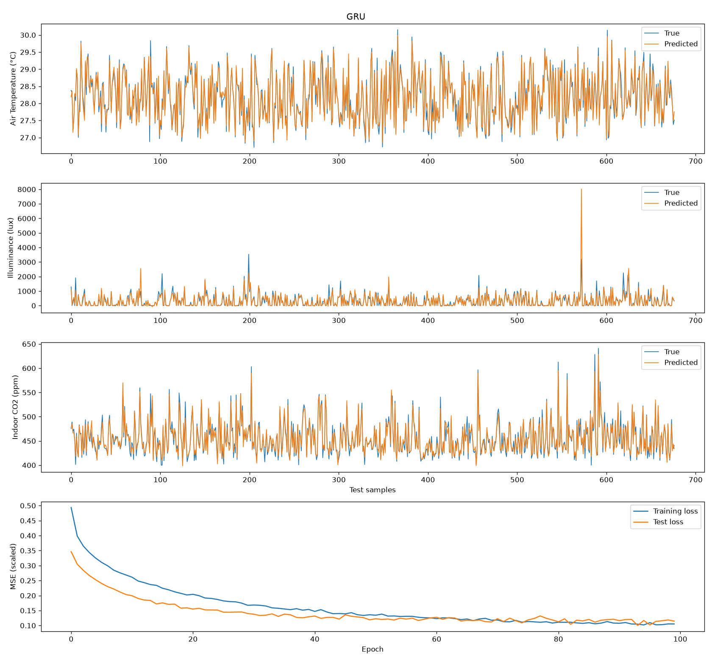

# ComfyWatt: Predicting Indoor Comfort in Smart Buildings

Hackathon project by **Team ComfyWatt**: Youssef Sabiri, Abdellah Elouazzani, Taoufyq Elansari (2024).

ComfyWatt is a smart-building concept that uses sensors and AI to keep occupants comfortable while cutting energy use. This repository holds its machine-learning prototype: deep learning models that predict a room's **air temperature**, **light level** and **CO₂ concentration** from its other sensor, HVAC, weather and occupancy readings.



## What the notebook does

1. **Loads the ROBOD dataset**: 5 rooms of a net-zero energy university building in Singapore, one reading every 5 minutes.
2. **Visualizes missing sensor data** across all rooms.
3. **Cleans and prepares Room 5** (a library space, 13,536 readings over 47 days): fills gaps with column means and drops energy-use, Wi-Fi and VOC columns. That leaves 25 input features.
4. **Trains three recurrent models**, each for 100 epochs with the Adam optimizer and MSE loss:
   - **LSTM**: 2 × LSTM(100), each followed by dropout
   - **GRU**: 2 × GRU(100), each followed by dropout
   - **BiLSTM + DNN**: 2 × Bidirectional LSTM(100), then Dense(100) and Dense(20)
5. **Evaluates** each model on a held-out 5% test set in real units (°C, lux, ppm) with MAE, RMSE and R².

## Results

Test-set results from the notebook run saved in this repository (seed 42).

**R² (higher is better, 1.0 = perfect):**

| Model | Air temperature | Illuminance | Indoor CO₂ |
|---|---|---|---|
| LSTM | 0.964 | 0.632 | 0.952 |
| GRU | 0.966 | **0.672** | 0.943 |
| BiLSTM + DNN | **0.976** | 0.346 | **0.967** |

**Mean absolute error:**

| Model | Air temperature (°C) | Illuminance (lux) | Indoor CO₂ (ppm) |
|---|---|---|---|
| LSTM | 0.090 | 91.1 | 5.80 |
| GRU | 0.094 | 88.4 | 6.22 |
| BiLSTM + DNN | **0.071** | **87.2** | **4.84** |

- **Temperature and CO₂ are predicted accurately** by all three models: within about 0.1 °C and 5–6 ppm on average.
- **Illuminance is the hardest target.** Light levels have rare, very bright spikes, probably from direct sunlight, which the models sometimes over- or under-shoot. A few large misses pull R² down, especially for the BiLSTM, even though its average error is the lowest.

## Repository structure

```
├── notebooks/   comfywatt_comfort_prediction.ipynb, the full pipeline with saved outputs
├── figures/     Missing-data chart and GRU predictions (used in this README)
├── docs/        Project proposal: concept, business case, alignment with the UN SDGs
├── data/        Where to put the ROBOD data (not included, see below)
└── requirements.txt
```

## How to run

1. **Get the data.** Download the `Data/` folder from the [ROBOD repository](https://github.com/ideas-lab-nus/robod) and copy the five `combined_Room*.csv` files into `data/robod/`.
2. **Install and run:**

```bash
git clone https://github.com/Abdell-EL/comfywatt.git
cd comfywatt
python -m venv .venv
source .venv/bin/activate        # Windows: .venv\Scripts\activate
pip install -r requirements.txt
jupyter notebook notebooks/comfywatt_comfort_prediction.ipynb
```

A full run takes about 10 minutes on a laptop CPU. A GPU isn't needed.

## Limitations and next steps

- **One reading at a time.** Each model sees a single 5-minute reading, not a sequence, so the recurrent layers don't use history. Feeding a window of past readings would let the models forecast comfort ahead of time, which is what building control needs.
- **Random split.** The test rows are picked at random from the whole period, so neighbouring readings can end up in both training and test sets. A split by date (e.g. training on the first weeks and testing on the last one) would give a stricter evaluation.
- **One room.** Only Room 5 is modelled. Testing on the other four rooms would show whether the models generalize across space types.

## Credits

- **Dataset:** ROBOD, collected at the National University of Singapore. Tekler, Z. D., et al. "ROBOD, room-level occupancy and building operation dataset." *Building Simulation*, 2022. [doi:10.1007/s12273-022-0925-9](https://doi.org/10.1007/s12273-022-0925-9)
- The dataset description, loading code and missing-data chart (notebook sections 1–2) are adapted from the ROBOD authors' [example notebook](https://github.com/ideas-lab-nus/robod).
